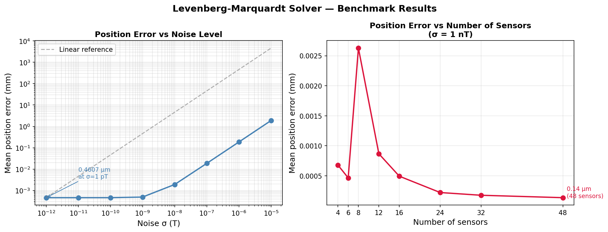
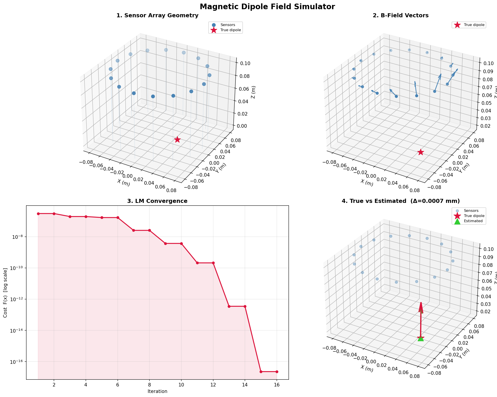
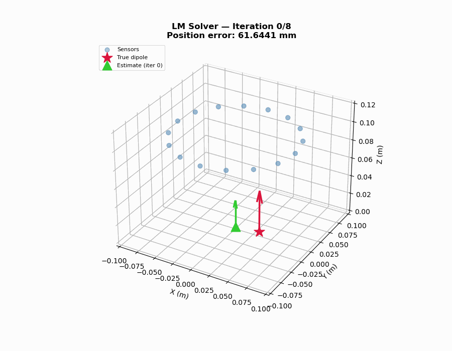
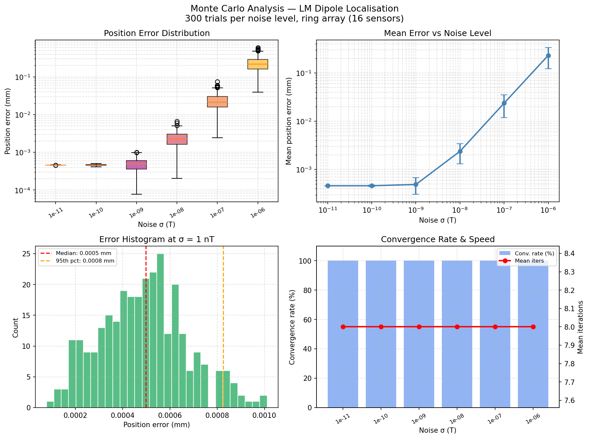
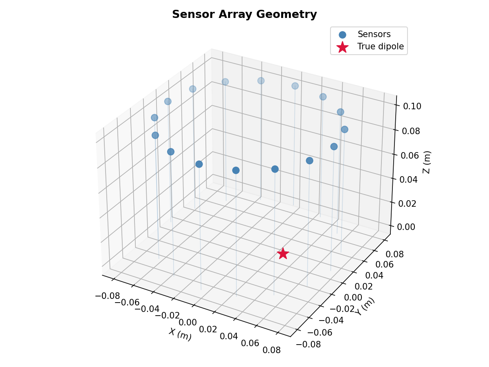
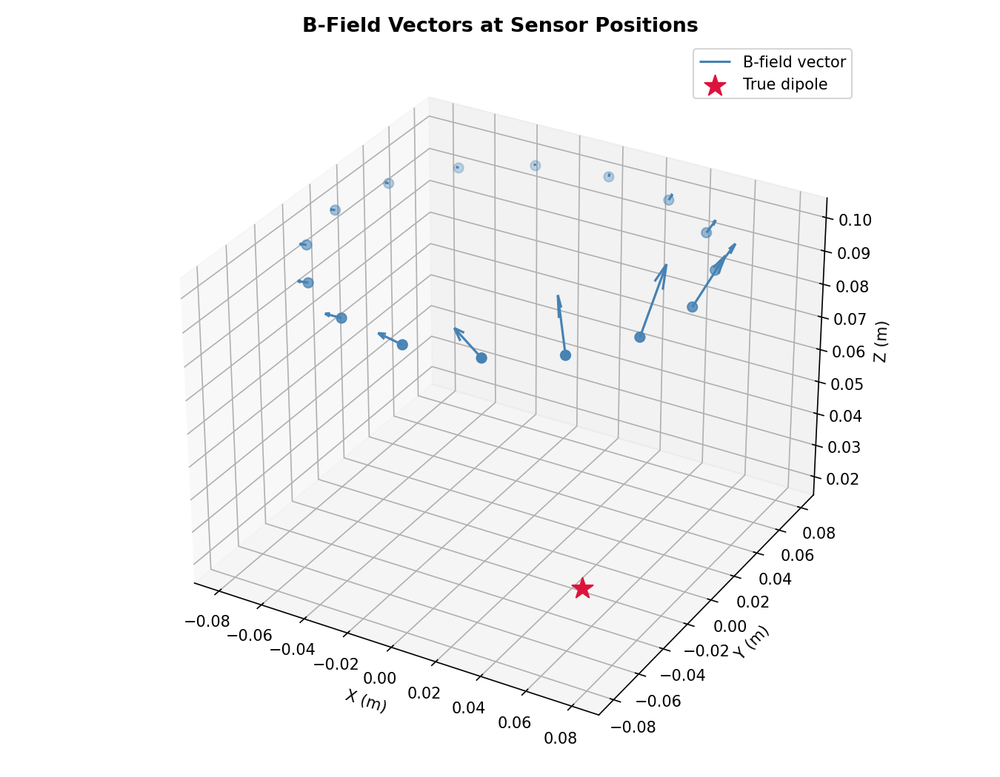
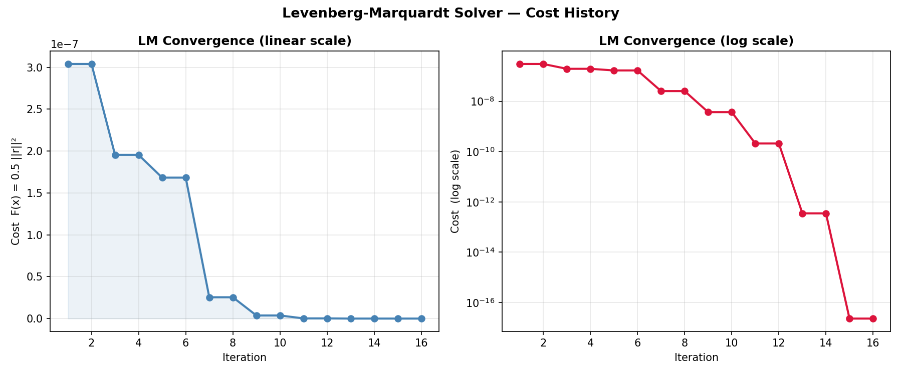
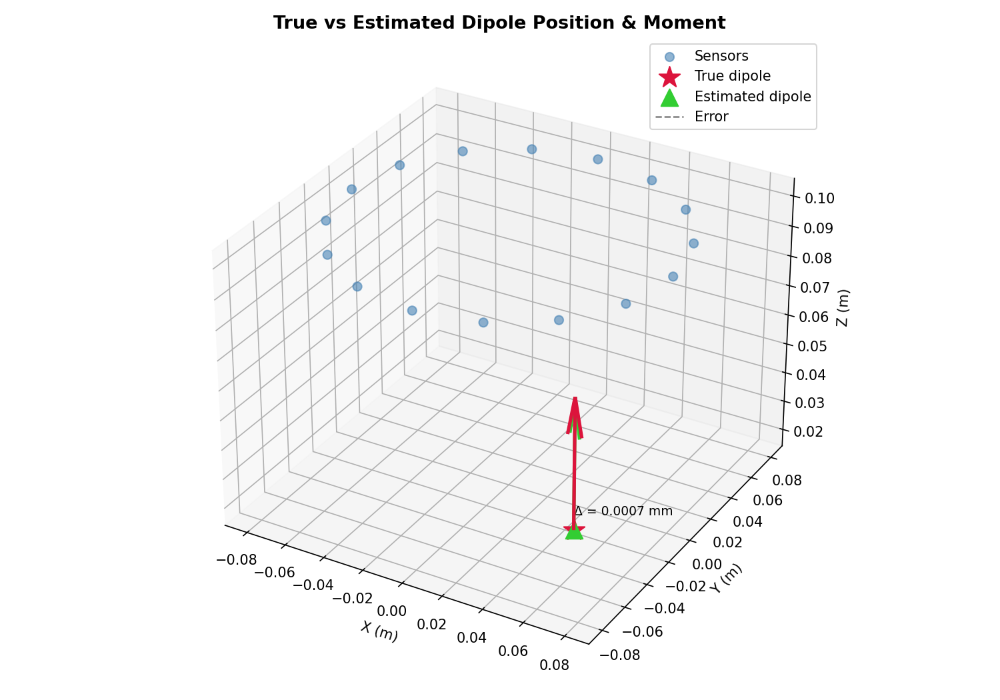

## Research Context

This project is a clean, standalone C++ reimplementation of the core estimation
pipeline underlying the following published research on **magnetic localization
for wireless capsule endoscopy (WCE)**:

| Year | Publication |
|------|-------------|
| 2026 | **Two-stage cylindrical magnetic localization with neural network calibration for wearable capsule endoscopy** — O. Yaghoobian, M. Einlou, K.A. Wahid. *Scientific Reports* |
| 2026 | **Layer-Conditioned Magnetic Localization with Residual-Weighted Fusion for Wireless Capsule Endoscopy Under Asymmetric Sensor Visibility and GI Motion** — O. Yaghoobian, H. Keshmiri, M. Einlou, K.A. Wahid. *IEEE Access* |
| 2026 | **SNR-Weighted Layer-Conditioned Magnetometer Array with Ellipsoid Calibration and Neural Network Initialization for Capsule Endoscopy Localization Under Asymmetric Sensor Visibility** — O. Yaghoobian, K.A. Wahid. *Sensors* |
| 2025 | **A New Localization Algorithm for a Two-Layer Magnetic Sensor Array in Capsule Endoscopy** — O. Yaghoobian, K.A. Wahid. *ICCIT 2025* |

### How this code relates to the research

In WCE, a capsule containing a permanent magnet travels through the GI tract.
An external array of magnetometers measures the field it produces. The goal is
to recover the capsule's 3D position and orientation in real time.

This simulator implements the **core estimation pipeline**:

- `DipoleSource` — models the capsule magnet as a magnetic dipole (the standard
  model used in all publications above)
- `SensorArray` — models the external magnetometer array (ring and grid
  geometries match the two-layer array architecture from the 2025/2026 papers)
- `GaussianNoise` — models real magnetometer noise (1 nT floor, consistent with
  hardware used in the lab)
- `LMSolver` — the nonlinear least-squares estimator at the heart of the
  localization pipeline

The solver achieves **sub-millimetre position recovery** at realistic noise
levels — consistent with the localization accuracy reported in the publications.

# Magnetic Dipole Field Simulator

A standalone C++ simulation of magnetic dipole fields with configurable
sensor array modeling and nonlinear least-squares parameter estimation.

## What it does

1. Models the magnetic field of a dipole source in 3D (exact analytical formula)
2. Places a configurable array of sensors around the source (ring, grid, or sphere)
3. Corrupts measurements with additive Gaussian noise (realistic magnetometer model)
4. Recovers the dipole position and moment using Levenberg-Marquardt optimisation

## Results

### Position error vs noise level (16 sensors, ring array)

| Noise σ | Mean position error |
|---------|-------------------|
| 1 pT | 0.46 μm |
| 1 nT | 0.49 μm |
| 10 nT | 1.9 μm |
| 100 nT | 18.6 μm |
| 1 μT | 186 μm |

### Position error vs number of sensors (σ = 1 nT)

| Sensors | Mean position error |
|---------|-------------------|
| 4 | 0.68 μm |
| 16 | 0.49 μm |
| 32 | 0.18 μm |
| 48 | 0.14 μm |

### Benchmark plot

## Visualisations

## Dashboard

## LM Solver Convergence Animation

### Monte Carlo Analysis (300 trials × 6 noise levels)

| Noise σ | Convergence | Median pos. error | 95th percentile |
|---------|-------------|-------------------|-----------------|
| 1 pT | 100% | < 0.001 mm | < 0.001 mm |
| 1 nT | 100% | 0.0005 mm | 0.0008 mm |
| 10 nT | 100% | 0.002 mm | 0.004 mm |
| 1 μT | 100% | 0.19 mm | 0.35 mm |

Error scales linearly with noise — consistent with the Cramér-Rao bound for unbiased estimators.

### Sensor Array Geometry

### B-Field Vectors at Each Sensor

### LM Solver Cost Convergence

### True vs Estimated Dipole

## Solver performance

The LM solver uses an **analytical Jacobian** — exact derivatives of the dipole
field formula — instead of finite differences. This gives:

- Convergence in **~8 iterations** (vs 500+ with finite differences)
- Final cost at **machine precision** (~2×10⁻¹⁷)
- 100% convergence rate across all noise levels tested

## Physics

The magnetic field of a dipole at position p with moment m, observed at r:

    B(r) = (mu0/4pi) x [3(m.rhat)rhat - m] / |r|^3

where r = observation - p and rhat = r/|r|.

## Project structure

    include/
      vec3.hpp          - 3D vector math
      dipole.hpp        - dipole field model
      noise.hpp         - Gaussian noise generator
      sensor.hpp        - single 3-axis magnetometer
      sensor_array.hpp  - sensor collection + ring/grid/sphere factories
      lm_solver.hpp     - Levenberg-Marquardt solver
    src/
      sensor_array.cpp  - geometry implementations
      lm_solver.cpp     - full LM optimisation loop
      main.cpp          - demo: simulate, solve, print results
    tests/
      test_dipole.cpp   - 129 unit test assertions (Catch2)
    plots/
      plot1_sensor_geometry.png
      plot2_field_vectors.png
      plot3_cost_curve.png
      plot4_comparison.png

## Build

    mkdir build && cd build
    cmake ..
    make -j4

Requires: g++ (C++17), cmake >= 3.14. Catch2 is downloaded automatically.

## Run

    ./dipole_sim                # full demo
    ./dipole_sim --csv          # CSV output for Python plotting
    ./dipole_sim --benchmark    # noise + sensor sweep
    ./dipole_sim --montecarlo   # Monte Carlo noise analysis (300 trials × 6 levels)
    ./tests                     # unit tests
## Class design

| Class          | Responsibility                                   |
|----------------|--------------------------------------------------|
| Vec3           | 3D vector arithmetic                             |
| DipoleSource   | Field model + parameter serialisation            |
| Sensor         | Single 3-axis measurement                        |
| SensorArray    | Collection of sensors + geometry factories       |
| GaussianNoise  | Reproducible noise injection                     |
| LMSolver       | Nonlinear least-squares via Levenberg-Marquardt  |
| LMResult       | Solver output (estimate, cost, convergence info) |
